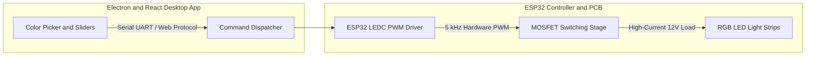

# Smart LED Controller Suite — Full-Stack IoT Lighting System

> Production-grade ambient lighting ecosystem comprising a custom KiCad hardware PCB, ESP32 PWM firmware, and an Electron + React desktop controller application.

[](https://www.kicad.org/)
[](https://www.espressif.com/)
[](https://www.electronjs.org/)
[]()
[](LICENSE)

---

## Overview

The **Smart LED Controller Suite** is a full-stack IoT ambient lighting solution built from schematic to user interface.

The system controls multi-channel 12V/5V RGB LED strips through high-frequency PWM switching. Users adjust color palettes, brightness curves, and automated lighting profiles via a desktop Electron application communicating with an onboard ESP32 controller.

---

## Features

- **Custom KiCad PCB**: High-current MOSFET switching stages designed in KiCad 10, complete with schematic, 3D footprint clearances, and thermal relief ground planes.
- **Smooth 8-Bit Hardware PWM**: ESP32 `ledc` peripheral operating at 5 kHz eliminates visual flickering across all dimming ranges.
- **Cross-Platform Electron Desktop App**: Modern desktop GUI built with React 18, color pickers, and automated serial connection management.
- **Full-Stack Architecture**: Demonstrates complete end-to-end integration across PCB hardware design, embedded microcontroller C++, and desktop frontend engineering.

---

## Hardware Specifications

| Parameter | Specification |
|---|---|
| **MCU** | ESP32 NodeMCU-32S (Xtensa LX6) |
| **Output Channels** | 3x High-Current PWM Channels (R: `GPIO 25`, G: `GPIO 26`, B: `GPIO 27`) |
| **PWM Frequency** | 5 kHz (8-bit resolution, 256 duty steps per channel) |
| **Operating Voltage** | 5V Logic, 12V LED Load Rail |
| **PCB Tool** | KiCad 10.0 (`LED_Controller.kicad_pro`) |

---

## System Architecture



---

## Project Structure

```text
smart-led-controller-suite/
├── hardware/                        # KiCad 10 Hardware Design
│   ├── LED_Controller.kicad_pro     # Project configuration
│   ├── LED_Controller.kicad_sch     # Schematic (MOSFET drivers, power filtering)
│   └── LED_Controller.kicad_pcb     # 2-layer PCB layout with copper ground planes
├── firmware/                        # ESP32 Embedded Firmware (PlatformIO)
│   ├── src/main.cpp                 # LEDC PWM hardware driver
│   └── platformio.ini
├── desktop_app/                     # Electron + React Desktop Application
│   ├── public/electron.js           # Electron main process & IPC bridges
│   ├── src/                         # React UI, color wheel, preset manager
│   ├── package.json
│   └── package-lock.json
└── README.md
```

---

## Getting Started

### 1. Flashing the Firmware

```bash
cd firmware
pio run --target upload
```

### 2. Running the Desktop Controller

Requirements: [Node.js](https://nodejs.org/) (v18+ recommended).

```bash
cd ../desktop_app
npm install
npm start
```

---

## Author

**Salah Lai**
- GitHub: [@SalahLai](https://github.com/SalahLai)
- Email: salah.lai.icloud@gmail.com

---

## License

This project is open-source and licensed under the [MIT License](LICENSE).
